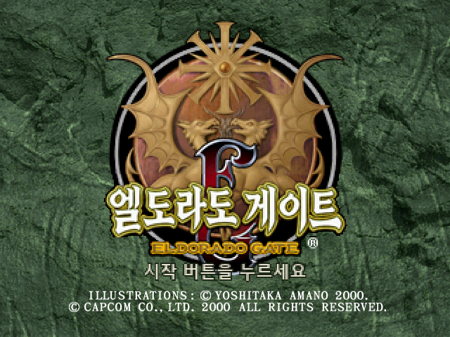
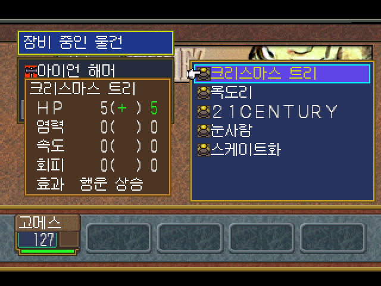
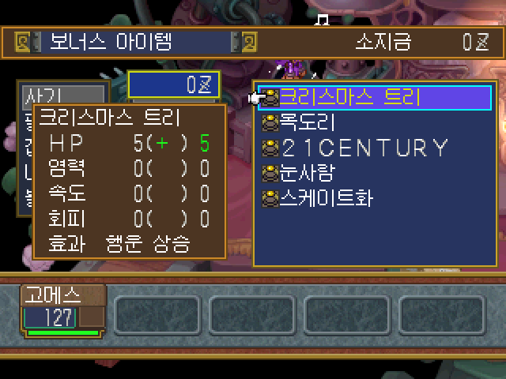
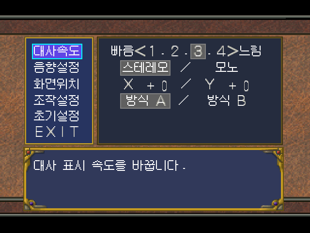
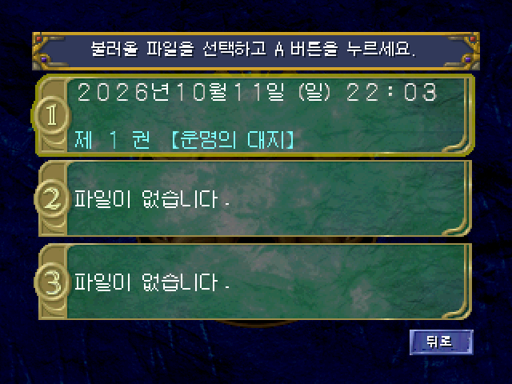
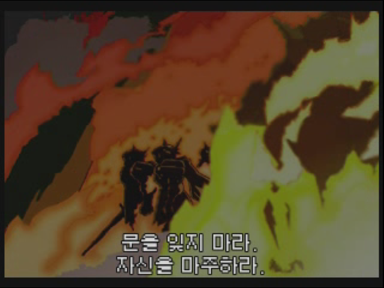
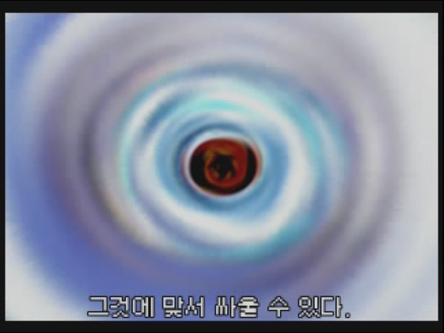

# El-Dorado-Gate-Volume-1-Kr · 한글 패치 v0.75

드림캐스트 **엘도라도 게이트 Vol.1 일본판 v1.002**의 한글 패치입니다.
대사·UI·저장/불러오기 제목·아이템명과 오프닝 자막을 반영했고,
**원본 Vol.1 디스크에 들어 있던 보너스 장신구 5종을 오프라인 상점에서 구매할 수 있도록 언락했습니다.**

**전체 플레이 검증 전의 공개 테스트판입니다.** 현재 릴리스 버전은 `v0.75`, 내부 검증 빌드는 `1.7.2`입니다.



## 다운로드 및 적용

1. [v0.75 릴리스](https://github.com/OldManCraveGuitars-bit/El-Dorado-Gate-Volume-1-Kr/releases/tag/v0.75)에서 `El-Dorado-Gate-Volume-1-Kr-v0.75.zip`을 받습니다.
2. ZIP 전체를 압축 해제하고 `El-Dorado-Gate-Volume-1-Kr-v0.75-Patcher.exe`를 실행합니다.
3. 일본판 v1.002 원본 GDI와 새 출력 폴더를 선택한 뒤 **한글 패치 적용**을 누릅니다.
4. 완성된 폴더의 `El-Dorado-Gate-Volume-1-Kr-v0.75.gdi`를 에뮬레이터에서 실행합니다.

Windows 64비트용 패처이며 Python 설치가 필요 없습니다.
원본 GDI와 세 트랙은 사용자가 준비합니다. 배포 파일에는 원본/완성 ROM, BIOS, VMU 저장 파일을 포함하지 않습니다.
패처는 원본을 읽고 새 폴더에 결과를 만듭니다. 이미 있는 출력 폴더에는 쓰지 않습니다.
실행할 GDI와 `track01.bin`, `track02.raw`, `track03.bin`은 같은 폴더에 두세요.

## 보너스 장신구 5종 언락

Vol.1 자체의 장신구 데이터와 원래 다운로드 상점 처리 코드를 재사용했습니다.
사령실의 다운로드 상점 담당 NPC와 원래 대화를 마치면 상점이 열리도록 연결하고,
외부 다운로드 파일이 없는 저장 데이터에서도 다음 5종이 재고에 표시되도록 했습니다.
**인터넷 연결이나 다른 권의 DLC 파일 없이 이용할 수 있습니다.**

| 아이템 | 원본 ID | 내용 |
| --- | --- | --- |
| 크리스마스 트리 | `0xF5` | Vol.1에 있던 장신구. 장비 화면에서 HP +5 및 행운 상승 표시 확인 |
| 목도리 | `0xF9` | Vol.1에 있던 장신구 |
| 21CENTURY | `0xFE` | Vol.1에 있던 장신구. 원래 영문 이름 유지 |
| 눈사람 | `0xF7` | Vol.1에 있던 장신구 |
| 스케이트화 | `0xF8` | Vol.1에 있던 장신구 |

기존 아이템을 새로 만들거나 다른 권에서 가져오지 않았습니다. **원래 가격·능력치·효과를 유지합니다.**
인벤토리에 자동 지급하지 않으며 상점에서 구매하는 방식입니다.



위 화면은 공개 게임 데이터로 새 부팅한 뒤 시험 VMU를 불러와 확인한 장비 화면입니다.
5종 구매·장비 표시·VMU 저장·재불러오기와 필드 복귀를 확인했습니다.
구매/저장 검증은 **시험용 무료 가격과 여관 저장 연결**을 사용했습니다.
해당 시험용 변경과 시험 저장 파일은 배포 패치에 포함되지 않습니다.
**일반 스토리 진행으로 상점까지 도달하고 원래 가격으로 구매하는 전 과정은 아직 검증하지 않았습니다.**

<details><summary>상점 검증 화면 보기 — 시험용 무료 가격</summary>



이 화면의 0 가격은 시험 환경입니다. 공개 패치의 가격은 일본판 원본과 같습니다.

</details>

## 한글화 내용

- 추출 항목 16,313개 중 번역 16,182개, 원본 유지/비언어 데이터 131개. 추출 목록 기준 미번역 0개.
- 일본어 원문과 한국어의 고유 번역 쌍 5,792개를 2차 대조 검수.
- 대사·시스템 메시지, 적 이름 44개, 아이템명 레코드 10,941개, 저장 정보와 브라우저 문구 반영.
- 원래 디자인을 사용한 한글 로고, 메뉴 글씨 정렬·크기·그림자·잔여 도트 정리.
- 저장 제목 한글화 및 `제 1 권 제 1 화 [제목]` 형식, 숫자와 문장부호 위치 수정.
- 설정 화면의 X/Y 수치 분리, 스테레오/모노 및 방식 A/B 정렬, 물결표 중앙 배치.
- 띄어쓰기는 반각 공백. 자판·영문 간판·배경 그래픽은 원본 유지.




## 오프닝 자막

화면 문구 16구간과 사용자가 확인한 가사 9구간을 적용했습니다.
가사가 없다고 확인한 두 구간은 제외했습니다.
원래 영문 화면을 유지하고 한글 자막을 추가하며, 화면 문구와 노랫말이 겹치면 위/아래로 구분합니다.
원본 ADX 음성 2,214개 섹터와 디코딩 PCM이 원본과 일치합니다.





## 검증 범위와 남은 작업

원본·패치 결과 해시, 변경 섹터 EDC/ECC, 자막 검사 25개와 편집기 화면/기능 검사 47개를 통과했습니다.
편집기 EXE로 생성한 전체 게임 이미지와 배포 대상 49개 게임 파일이 일치합니다.
Flycast HLE 일반 부팅에서 가사 9구간 표시와 영상 종료 후 한글 타이틀 복귀를 확인했습니다.

남은 검증: 전체 정상 플레이, 정상 경로의 보너스 상점 접근/구매, 수정된 훔치기 전투 문구 2종,
큰 글씨 물결표 표시. 실기·실제 BIOS에서의 구동도 미검증입니다.
추출 목록의 미번역 0개는 모든 게임 화면의 누락 없음이나 전체 클리어 검증을 뜻하지 않습니다.

검증 자료: [verification.json](docs/verification.json), [스크린샷 출처와 시험 조건](docs/screenshot-provenance.json).

## 원본 / 적용 후 SHA-256

| 파일 | 원본 SHA-256 | v0.75 적용 후 SHA-256 |
| --- | --- | --- |
| `track01.bin` | `5b4a5857228be738a116dd8487255a0eca81e6874ab6febdca646369e7ea81bf` | `5b4a5857228be738a116dd8487255a0eca81e6874ab6febdca646369e7ea81bf` |
| `track02.raw` | `cd7c82d88f21e4ebb32a94c65f15f625df871c933d6d78cbf85c671778a6ffca` | `cd7c82d88f21e4ebb32a94c65f15f625df871c933d6d78cbf85c671778a6ffca` |
| `track03.bin` | `85d40e5ded0b29bb5a6e3c9e53054ec15bafe2bbf65a10b7c81a7612b75a7b80` | `90f85e04aa7b8fb353806ee916ab6ef1ba5a07eb9f918f035308a13565a4f733` |

[상세 해시 및 적용 대상](docs/HASHES.md) · [49개 변경 게임 파일의 전후 해시](docs/changed-files-sha256.json).

## 사용 도구와 글꼴

패처 소스는 [tools/patcher.py](tools/patcher.py)에 있습니다.
xdelta3 3.2.1: [공식 소스/릴리스](https://github.com/jmacd/xdelta/releases/tag/v3.2.1), Apache 2.0.
갈무리 및 MaruMinya 글꼴은 SIL Open Font License 1.1을 따릅니다. [라이선스](licenses/).
이 저장소에 새로 작성한 패처 코드는 MIT 라이선스입니다. 원작 게임과 상표의 권리는 원 권리자에게 있습니다.

## 패처 소스 빌드

Python 3.13과 PyInstaller 6.22.3으로 Windows x64 EXE를 만들었습니다.
Python에 PyInstaller를 설치하고 공식 xdelta3 3.2.1 Windows x64 바이너리를 준비한 뒤 실행합니다.

```powershell
python -m pip install PyInstaller==6.22.3
.\tools\build-patcher.ps1 -Xdelta 'C:\경로\xdelta3.exe'
```

`dist`의 EXE와 릴리스 ZIP의 `track03-v0.75.xdelta`를 같은 폴더에 두면 실행할 수 있습니다.
이 소스는 배포용 적용 패처입니다. 대사·이미지 편집기는 별도의 내부 프로젝트 도구입니다.
